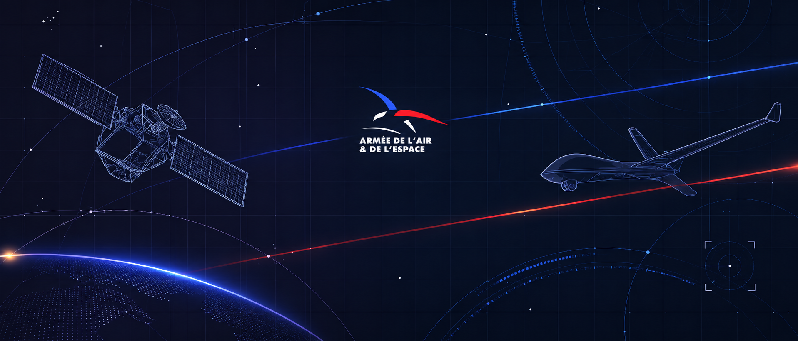

# Mes réponses et ma démarche pour le CTF proposé par l'AAE

---

> **Utilisation de l'intelligence artificielle**
>
> Dans le but d'améliorer la lisibilité, la structuration et la qualité rédactionnelle de ces documents, j'ai utilisé des outils d'intelligence artificielle pour reformuler et mettre en forme les notes brutes prises au cours de la réalisation du CTF.